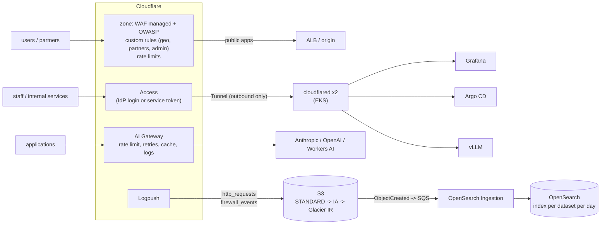

# terraform-cloudflare-edge

[](https://github.com/ozy31/terraform-cloudflare-edge/actions/workflows/ci.yml)


Terraform modules for the Cloudflare edge in front of an AWS/EKS platform:
WAF and geo-fencing for regulated multi-market traffic, rate limiting, Logpush to S3
with tiered storage and OpenSearch indexing, Cloudflare Tunnel + Access to publish
internal tools and a self-hosted LLM without a public load balancer, and AI Gateway
in front of third-party model APIs.

It is the edge layer for [terraform-aws-eks-platform](https://github.com/ozy31/terraform-aws-eks-platform)
and [terraform-aws-eks-ai-cluster](https://github.com/ozy31/terraform-aws-eks-ai-cluster).
Everything is managed as code with the Cloudflare provider v5 instead of dashboard clicks,
so every WAF change is reviewed, versioned and reversible.

> Account IDs, zone IDs and IP ranges in `examples/` are placeholders (RFC 5737 documentation ranges).

## Contents

- [Architecture](#architecture)
- [Modules](#modules)
- [Usage](#usage)
- [Design decisions](#design-decisions)
- [Operations](#operations)
- [Plan requirements](#plan-requirements)
- [Development](#development)

## Architecture



## Modules

| Module | What it creates |
|---|---|
| [`zone-security`](modules/zone-security) | Zone TLS settings (Full strict, TLS 1.2+, HTTPS only); Cloudflare Managed Ruleset and OWASP Core Ruleset with a configurable anomaly threshold; custom rules for a partner allow-list, a country geo-fence, office-only admin paths and API hygiene; rate limiting rules; account-level IP lists for partners and offices. |
| [`logpush-s3`](modules/logpush-s3) | Private TLS-only S3 bucket with lifecycle tiering (STANDARD → STANDARD_IA → GLACIER_IR → expire); Logpush jobs per dataset with an explicit field list, including the ownership challenge round-trip; optional S3 → SQS → OpenSearch Ingestion pipeline that writes one index per dataset per day. |
| [`tunnel`](modules/tunnel) | Remotely managed Cloudflare Tunnel, ingress rules, proxied DNS records, an Access application per hostname (IdP email domains and/or service tokens) and the `cloudflared` connectors in Kubernetes (two replicas across zones, PDB, non-root, read-only root filesystem, metrics). |
| [`ai-gateway`](modules/ai-gateway) | Cloudflare AI Gateway with authentication, rate limiting, retries with backoff, optional caching and logging, and per-provider base URLs as outputs. |

## Usage

```hcl
module "zone_security" {
  source = "github.com/ozy31/terraform-cloudflare-edge//modules/zone-security?ref=v0.1.0"

  account_id        = var.account_id
  zone_id           = var.zone_id
  name              = "prod"
  allowed_countries = ["TR", "DE", "NL", "GB"]
  partner_ips       = { "payment-provider-a" = "203.0.113.0/24" }

  rate_limits = {
    login = {
      expression          = "http.request.uri.path eq \"/api/auth/login\""
      requests_per_period = 10
      action              = "managed_challenge"
    }
  }
}

module "tunnel" {
  source = "github.com/ozy31/terraform-cloudflare-edge//modules/tunnel?ref=v0.1.0"

  account_id       = var.account_id
  zone_id          = var.zone_id
  name             = "prod-euw1"
  access_team_name = "example"

  services = {
    grafana = {
      hostname              = "grafana.example.com"
      service               = "http://kube-prometheus-stack-grafana.monitoring.svc:80"
      allowed_email_domains = ["example.com"]
    }
  }
}
```

Point an application at AI Gateway instead of the provider:

```bash
export ANTHROPIC_BASE_URL="$(terraform output -json ai_gateway_endpoints | jq -r .anthropic)"
# the app keeps its own ANTHROPIC_API_KEY and adds the gateway token:
#   cf-aig-authorization: Bearer <gateway token>
```

[`examples/complete`](examples/complete) wires all four modules together: a geo-fenced
production zone with partner bypass and login/API/LLM rate limits, logs indexed in
OpenSearch, Grafana / Argo CD / the vLLM endpoint from terraform-aws-eks-ai-cluster
published through a tunnel, and an AI Gateway for third-party models.

## Design decisions

**One module owns each ruleset phase.** Cloudflare allows exactly one entrypoint ruleset
per phase per zone. If Terraform owns `http_request_firewall_custom`, the dashboard must
not, or the next apply silently reverts someone's emergency rule. The emergency path is
a small PR, which takes about as long as clicking through the dashboard and leaves an audit trail.

**Partners skip custom rules and rate limits, never the managed WAF.** Payment providers
and data feeds come from fixed ranges, often from countries outside the geo-fence, and
send bursts. They get a `skip` for custom rules and rate limiting, but SQLi/XSS
inspection still applies: a compromised partner is still a threat.

**Geo-fence for licensing, with verified bots exempt.** In regulated markets the rule is
"serve only where licensed". `cf.client.bot` keeps search engine crawlers working.

**OWASP starts in `log`.** The Core Ruleset produces false positives on real APIs (JSON
bodies, long tokens). The rollout path is to log, review Security Events, add exceptions,
switch to `managed_challenge` or `block`, and tighten the score threshold from 60 to 40.

**No unauthenticated tunnel hostnames.** The `services` validation refuses a service
without an email domain or service token. `cloudflared` also enforces the Access JWT
(`origin_request.access.required`), so a mistake in an Access policy fails closed.
Machine clients get a 401 instead of a login redirect.

**Outbound-only access to internal tools.** Grafana, Argo CD and the LLM endpoint have
no public load balancer, no inbound security group rules and no VPN. Two `cloudflared`
replicas spread across zones each hold four connections to two Cloudflare data centres.

**Explicit Logpush fields.** "All fields" means paying to store and index columns nobody
queries. The default list is what incident response and WAF tuning actually use: Ray ID,
client IP/country/ASN, host, path, status, origin latency, cache status, security action
and WAF attack score.

**Tiered log storage.** Logs are queried heavily for a few weeks after an incident and
rarely afterwards, but audits need a year. STANDARD → STANDARD_IA at 30 days →
GLACIER_IR at 90 → expiry at 365 keeps that retention at a fraction of the cost, and
Glacier Instant Retrieval still returns data in milliseconds when an old incident is reopened.

**AI Gateway for third-party models, Tunnel + Access for self-hosted ones.** External
APIs need central rate limits, retries and cost visibility across teams. The self-hosted
vLLM needs authentication and reachability without exposure. Both get a WAF rate limit
at the edge.

## Operations

| Situation | What to do |
|---|---|
| False positive from the managed WAF | Find the Ray ID in Security Events or in the `firewall_events` index, note the rule ID, and add a scoped `skip` or override in a PR. Never disable the whole ruleset. |
| Attack on login | Lower `requests_per_period` for `login` or switch the action to `block`; apply takes seconds. |
| New market launch | Add the country code to `allowed_countries` in the same PR as the DNS / app change. |
| Tunnel down | `kubectl -n cloudflared get pods`, check `/ready` and the `cloudflared_tunnel_ha_connections` metric. The other replica keeps serving while one restarts. |
| Rotate a service token | Taint `cloudflare_zero_trust_access_service_token.this["<name>"]`, apply, and distribute the new secret from the sensitive output. |

## Plan requirements

| Feature | Cloudflare plan |
|---|---|
| Managed Ruleset, OWASP Core Ruleset | Pro and above |
| Rate limiting with `period = 60` | Pro/Business (10 s on Free; longer windows on Enterprise) |
| Logpush for zone datasets (`http_requests`, `firewall_events`) | Enterprise |
| Tunnel, Access (up to 50 users), AI Gateway | Free tier available |

## Development

```bash
make check      # fmt-check, validate, tflint, helm lint, trivy
make validate   # terraform init -backend=false + validate per module and example
make charts     # helm lint + render the cloudflared chart
```

CI runs the same steps on every push and pull request.

## License

MIT
